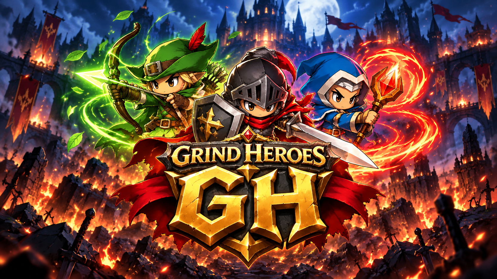
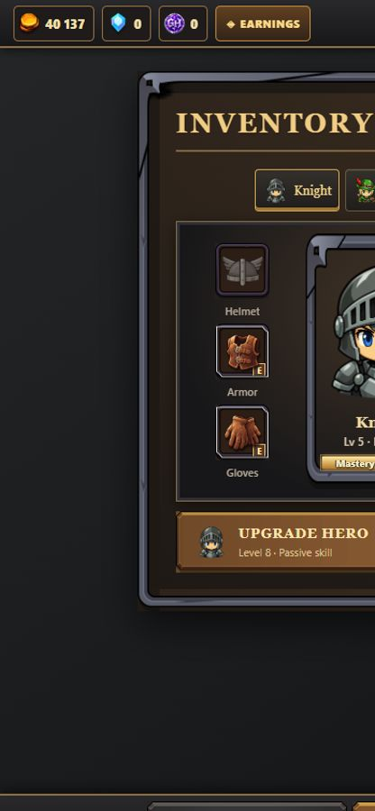
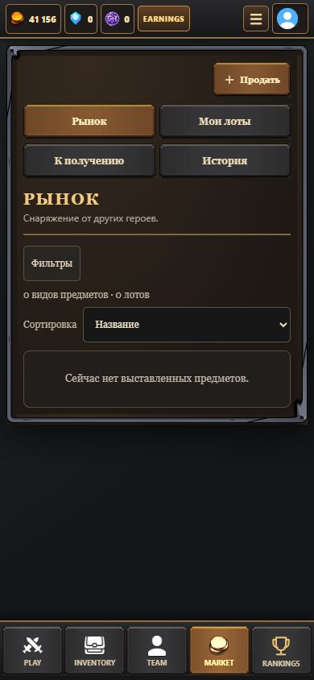
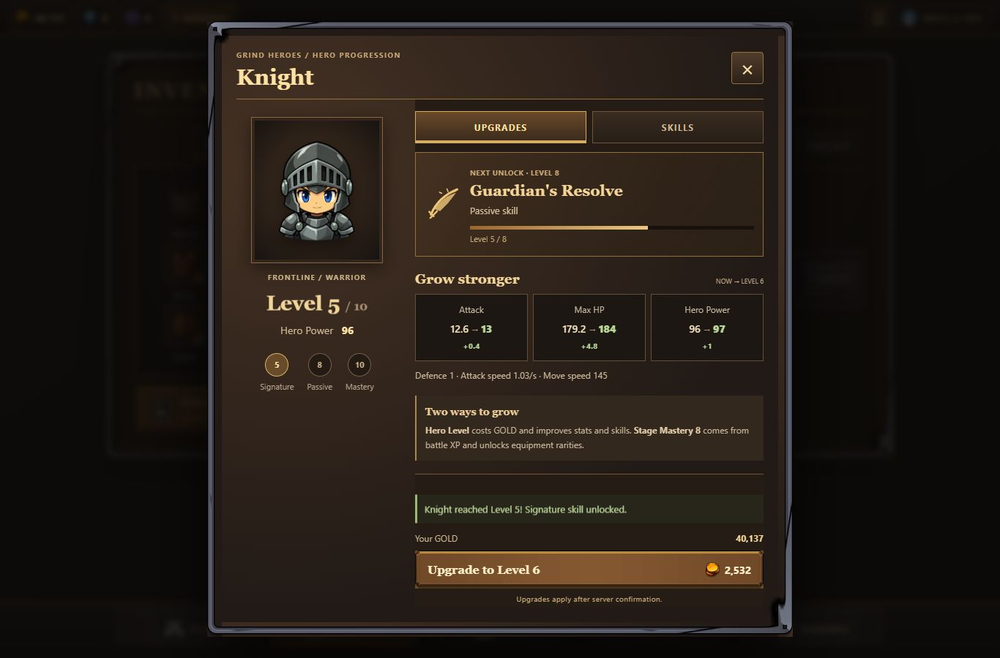
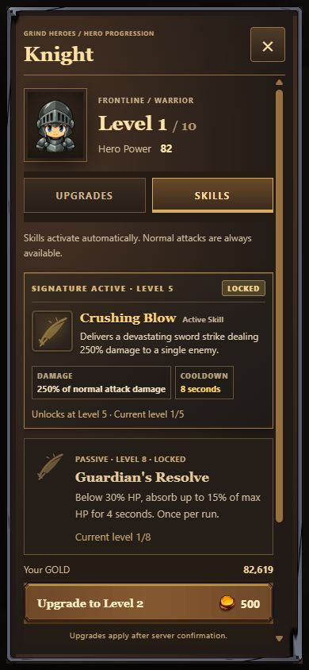
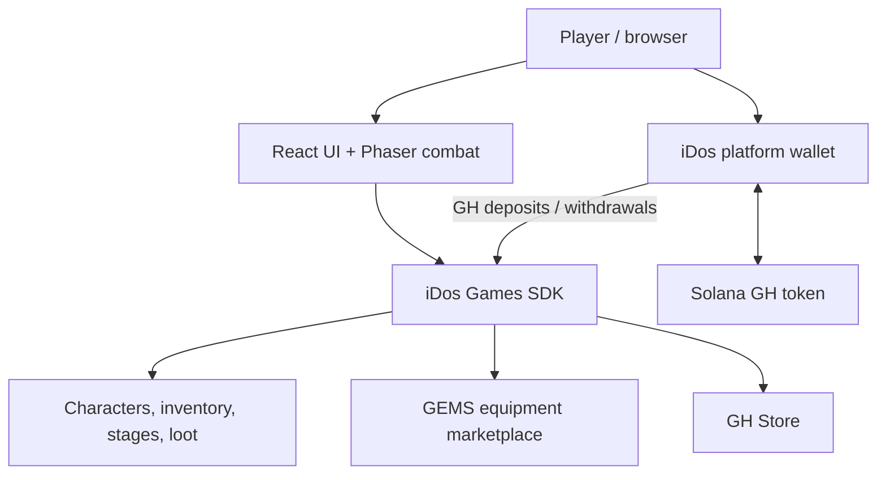
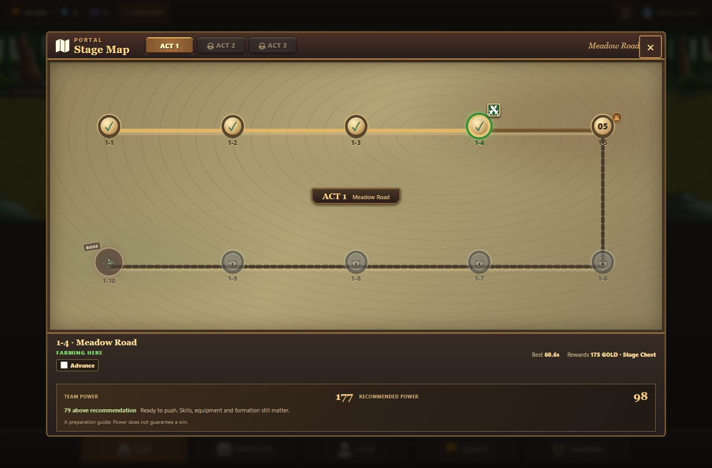

# GRIND HEROES

     

> **Build your party. Progress while AFK.** An idle RPG with automatic battles, lasting hero progression, valuable loot, and a player-driven game economy.

**[Play the live game](https://98jrcakg.idos.games/)** · [Watch the 2-minute demo](https://youtu.be/kQVqU1hUUec) · [Watch the founder pitch](https://www.loom.com/share/d6565085ef3d405696bf17fff49a7032) · [Colosseum project](https://colosseum.com/arena/projects/grind-heroes) · [Development notes](docs/feature-history/README.md)



## Try Grind Heroes in 2 Minutes

1. Open the [game](https://98jrcakg.idos.games/) and choose **Play as guest**.
2. Watch automatic combat and the first boss; a fresh tested 1-1 run takes about 68 seconds.
3. Open the earned chest, visit **Inventory** and **Equip Best**. The first clear also gives Traveler Boots.
4. Open **Upgrade Hero** from Inventory or Team. Compare stats and discover the Level 5 / 8 / 10 skill goals.
5. Explore the Stage Map, Team, Pets, Marketplace and Rankings. GH Earnings explains calculated allocations and unavailable payouts.

The starter 500 GOLD covers the first level upgrade. Level 5 and a full party
are longer-term goals, not two-minute promises. [Honest demo script](docs/JURY_DEMO.md).

## Built for short sessions and long progression

Not everyone has hours to play every day. Grind Heroes lets players check in, collect what their heroes earned while away, make a few meaningful choices, and leave the party fighting. Coming back means stronger heroes, new gear, and another stage to push.

The current web build is playable now. It has **three acts and 30 finite stages**, a party of up to three heroes, melee and ranged combat, bosses, equipment, chests, and an in-game marketplace.


*Actual capture in local DEV combat preview: three classes, with rewards disabled. Jury Edition is live on PROD as v82 (October 15, 2026). Earlier demo videos predate this release.*

## The game loop

```text
Build a party → Fight automatically → Earn GOLD and chests
       ↑                                   ↓
Push harder stages ← Upgrade and equip ← Open loot
                             ↕
                     Keep or trade gear
```

Knight, Archer, and Mage have different combat roles. Players recruit heroes, unlock party slots, level up and equip them, then choose a stage to progress through or farm. Stage and boss chests add gear across five rarity tiers. An AFK return grants accumulated GOLD, capped at eight hours.

| Equip the party | Browse player listings |
| --- | --- |
|  |  |

## Heroes, skills and progression

| Hero | Combat role | Level 5 signature | Level 8 passive |
| --- | --- | --- | --- |
| Knight | Frontline melee | Crushing Blow | Guardian's Resolve |
| Archer | Ranged damage | Rapid Fire | Piercing Precision |
| Mage | Ranged area damage | Meteor | Scorching Impact |

At **Hero Level 10**, each signature gains mastery. All abilities activate
automatically after unlocking; Levels 1–4 use normal attacks. Hero Level costs
GOLD and is stored in the native iDos character record. **Stage Mastery** uses
battle XP to unlock equipment rarities. Neither track resets existing progress.

Inventory answers “What should I equip?”, Team answers “Who fights?”, and the
separate Hero Progression window answers “How do I grow stronger?”. It previews
costs and stat gains, explains locked skills, and confirms upgrades with the
server. Play and Stage Map compare Team Power with stage recommendations.

| Hero Progression on desktop | Skills on mobile |
| --- | --- |
|  |  |

*Local DEV captures of the actual UI. See [progression and compatibility notes](docs/PROGRESSION.md).*

## A player-driven economy

Loot creates a choice: **equip an item for the next fight, keep it for another hero, or list eligible equipment for another player.** The live iDos Marketplace supports player listings and purchases of equipment priced in **GEMS**. Sale proceeds can go back into the game economy, including gear from other players.

The **GH token lives on Solana**. Players can deposit GH through the iDos Games platform wallet into their game balance and spend that balance in the in-game Store on GEMS or Premium Chests. A Premium Chest opens into a server-rolled equipment item. Durable character/item state and GEMS marketplace settlement are handled by iDos game services; combat simulation runs in the client with CloudCode stage/reward validation; this build does not present equipment as on-chain NFTs or price marketplace listings in GH.

### GH reward accounting is transparent

GH Earnings separates the **remaining accounting budget**, daily calculated
share, current reward window, pending review and confirmed lifetime receipts.
The accounting budget is not a live shared-pool balance. **GH payouts are
currently unavailable**: Claim is disabled, no financial probe is exposed, and
this branch does not change reward formulas, tokenomics or payout gates.
The DEV overview handler is currently unavailable; the UI reports that honestly.
[Economy and data-source details](docs/ECONOMY.md).

### Why Solana?

Solana gives GH a wallet-connected token network and an existing community familiar with digital assets. Its fast, low-cost transfers suit an economy players can enter and leave through deposits and withdrawals. The battle loop stays responsive because moment-to-moment gameplay runs through the game client and iDos services.

## What is playable

| Area | Current build |
| --- | --- |
| **Combat** | Automatic melee and ranged fights, stage selection, bosses, and 30 stages across three acts. |
| **Party** | Knight, Archer, and Mage; up to three active heroes; separate recruitment/slot purchases, Hero Levels, six equipment slots and Team Power. |
| **Loot** | Stage and boss chests, rarity-based equipment, inventory, and Premium Chests. |
| **Idle progress** | GOLD accumulated while away, with an eight-hour cap; completed stages remain available for automatic farming. |
| **Jury Edition branch** | Separate Hero Progression window, Level 5/8/10 skills, calibrated stage pressure and explicit GH payout restrictions; pending authorized release. |
| **Trading** | GEMS-priced equipment listings and purchases through the iDos Marketplace. |
| **GH utility** | Solana GH deposits through the platform wallet and server-backed Store offers for GEMS and Premium Chests. |

## How it is built

| Layer | Technology |
| --- | --- |
| Game simulation and rendering | Phaser 4 |
| Interface | React 19, TypeScript 5 |
| Build and local development | Vite 8 |
| Accounts, game state, and services | iDos Games SDK and host modules |
| Token network | Solana, through the GH token and iDos platform wallet |
| Verification | TypeScript typecheck and Node-based gameplay and economy tests |



### iDos Games integration

The host provides sign-in and the game session. iDos-backed characters, inventory, formation, lootboxes, Store, Marketplace, and server-side stage validation keep durable progress outside the Phaser scene. The platform wallet handles GH deposits and withdrawals; the game reads the resulting in-game GH balance for Store purchases. This lets a solo developer spend more time on combat, progression, content, and balancing.

This repository contains the **current React/Phaser hackathon client and its tests**. Title configuration and managed backend services live on iDos Games, so they are not represented as local JSON or smart contracts here. See [IDOS.md](IDOS.md) for the project map and [feature history](docs/feature-history/README.md) for implementation decisions.

## Campaign, pets and preparation

Three acts move from early goblin encounters to ranged pressure, armoured
frontlines and guarded bosses. Loot spans five rarities, with eligibility from
Stage Mastery. One owned pet supports the next run. Underprepared parties lose;
gear, levels, skill unlocks and party composition create measurable improvements.



Balance verification covers **8 real-config profiles × 30 stages × 3 deterministic
cadences = 720 simulations**. A bare starter clears the first four stages and
then loses; a Level-5/Common Knight can clear the first act, and a developed
Level-10/Epic trio can farm the campaign. [Metrics and methodology](docs/feature-history/jury-balance.md).

## Play or run locally

**For judges:** open the [live game](https://98jrcakg.idos.games/). Choose a sign-in method when prompted; **Play as Guest** is the quickest way to try the core game. For GH already deposited through an iDos Games account, sign in with that same account.

**For developers:** use a supported Node.js release and npm. The repository has a canonical Title ID in `src/idos.title.ts`; `.env.local` selects the DEV environment for a local run.

```bash
git clone https://github.com/gordon0027/GRIND-HEROES.git
cd GRIND-HEROES
npm install
cp .env.example .env.local
npm run dev
```

```bash
npm run typecheck
npm run build
npm test
```

Local development connects to the iDos DEV Title and its backend configuration. No credentials are needed in the repository.

`npm test` includes skill boundaries, atomic upgrade recovery, gear and party
rules, stage rollback, marketplace purchase settlement, GH accounting and payout
guards. The real DEV SDK tests are opt-in and use isolated guests; they are not
part of the offline suite. Browser evidence covers 320, 360, 390, 430, 768, 1366
and 1920 px. [QA report and limitations](docs/JURY_EDITION_REPORT_RU.md).

More: [Gameplay](docs/GAMEPLAY.md) · [Progression](docs/PROGRESSION.md) ·
[Economy](docs/ECONOMY.md) · [Judge demo](docs/JURY_DEMO.md).

## Status and next steps

- [x] Three-act campaign, automatic combat, bosses, and AFK GOLD
- [x] Three-hero party, equipment progression, and chest rewards
- [x] GEMS equipment marketplace and GH Store offers
- [x] Jury Edition implementation, progression boundaries, balance evidence and transparent Earnings
- [x] Jury Edition deployed to PROD as v82; hosted assets and live progression verified
- [ ] Expand content and keep tuning progression and the economy
- [ ] Explore broader token rewards and Solana-linked item features

## Colosseum 2026

GRIND HEROES was built by a solo founder for [Colosseum's Crypto World's Fair](https://colosseum.com/arena/projects/grind-heroes), with iDos Games integration.

| Founder | Role | Contact |
| --- | --- | --- |
| Adam Tukeyev | Solo Founder & Game Developer | [Telegram](https://t.me/abidelaw) · [X](https://x.com/adam2key) · [GitHub](https://github.com/gordon0027) |

**[Live game](https://98jrcakg.idos.games/)** · [Technical demo](https://youtu.be/kQVqU1hUUec) · [Founder pitch](https://www.loom.com/share/d6565085ef3d405696bf17fff49a7032) · [Project page](https://colosseum.com/arena/projects/grind-heroes)
