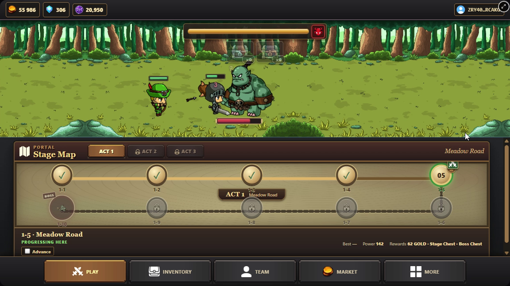
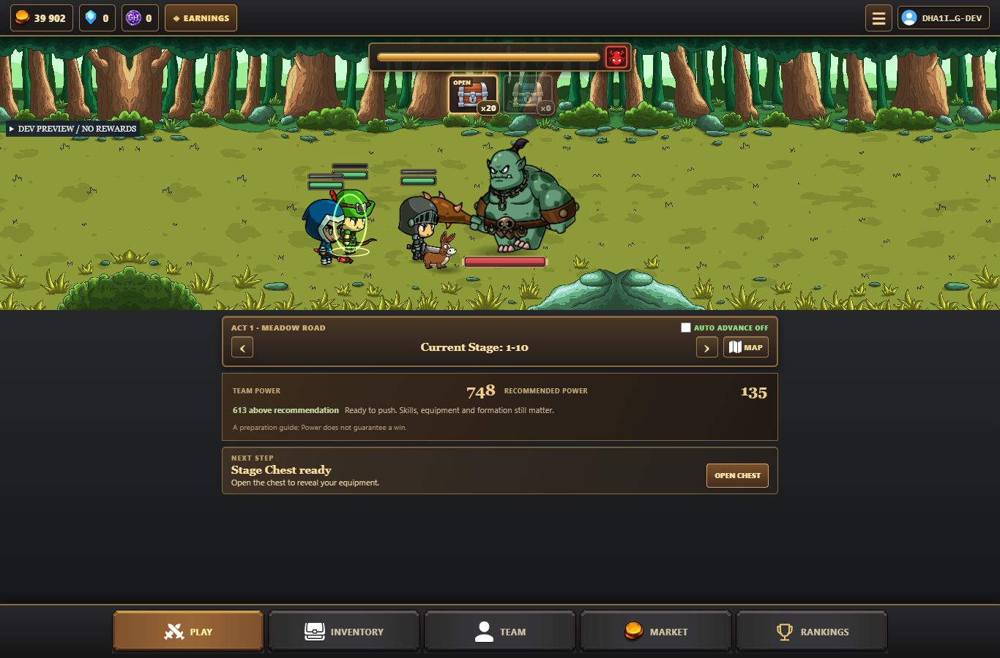
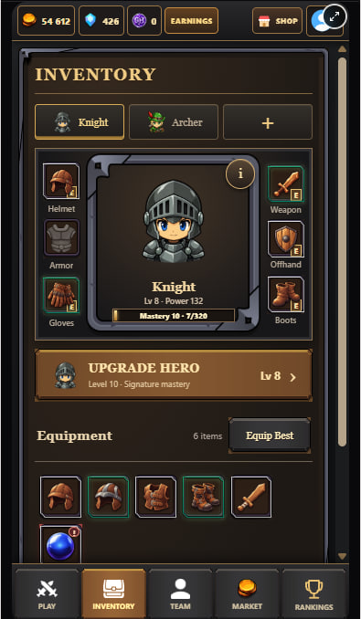
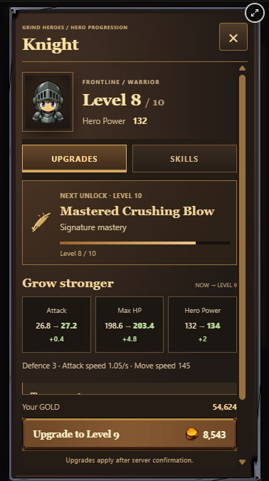
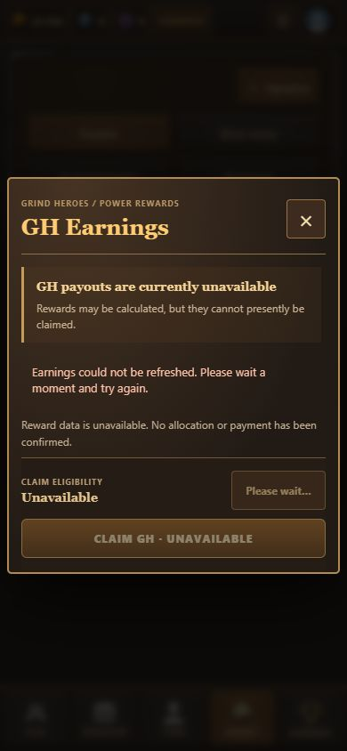
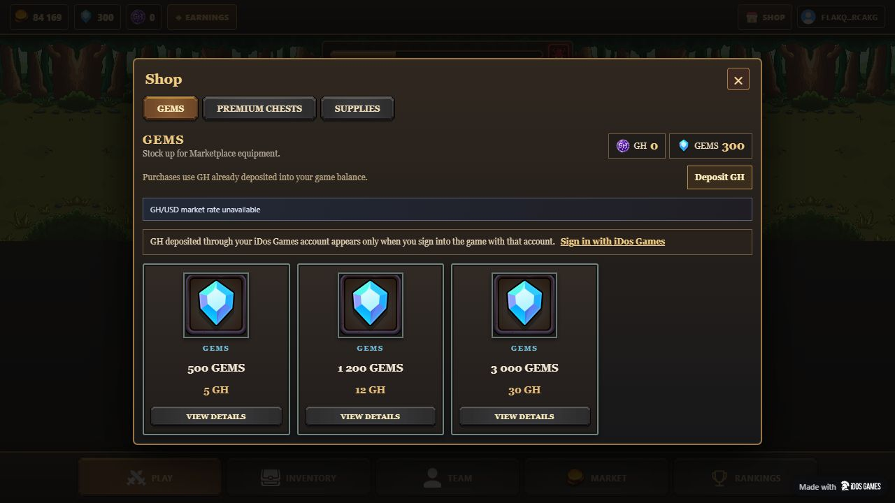

# GRIND HEROES


    

**Build a party. Let it fight. Come back stronger.** Grind Heroes is a playable idle fantasy RPG built with Phaser, React, TypeScript and iDos Games. Automatic combat, three hero classes, equipment, pets and a player marketplace feed a 30-stage campaign. Team Power adds a server-calculated Top 100; GH connects the game economy to Solana through the iDos platform wallet.

**[Play the live game](https://98jrcakg.idos.games/)** · [Two-minute walkthrough](docs/QUICK_START.md) · [Watch the demo](https://youtu.be/kQVqU1hUUec) · [Colosseum project](https://colosseum.com/arena/projects/grind-heroes)



*Gameplay capture from the live game. The current published build is v83; the demo video was recorded earlier.*

## What is Grind Heroes?

Choose a stage, watch your party battle automatically, collect rewards, improve your heroes and push farther. The campaign spans **three acts and 30 finite stages** with melee and ranged enemies, bosses, farming and auto advance. A guest account can start playing without a wallet.

```text
Fight → Earn GOLD, XP and chests → Improve heroes and gear
  ↑                                          ↓
Farm cleared stages ← Build Team Power ← Push harder stages
```

## Core Gameplay

| System | What players do |
| --- | --- |
| Automatic battles | Select a stage and let up to three heroes fight. Skills trigger automatically after they unlock. |
| Campaign | Clear 30 stages across Meadow Road, Orange Bastion and Undead Crypt, including a boss chest on every fifth stage. |
| Farming | Repeat cleared stages, or enable auto advance to try the next stage. Defeat returns the party to cleared-stage farming. |
| Idle return | Collect server-backed GOLD accrued while away, capped at eight hours. |
| Preparation | Compare Team Power with stage recommendations, then adjust heroes, equipment and a pet. The recommendation is guidance, not a gate. |

| Three-hero combat | Stage preparation |
| --- | --- |
|  |  |

*Additional captures show the current interface in the DEV title. The three-hero
combat image is a non-reward preview, not an earned guest party.*

## Heroes & Team Building

The **Knight** protects the front line, the **Archer** attacks from range, and the **Mage** brings area damage. Heroes are recruited and party slots are unlocked separately; owned heroes can then fill up to three active slots. GOLD buys native Hero Levels, while battle XP advances a separate Stage Mastery track that unlocks equipment rarities.

| Hero | Level 5 signature | Level 8 passive | Level 10 |
| --- | --- | --- | --- |
| Knight | Crushing Blow | Guardian's Resolve | Signature mastery |
| Archer | Rapid Fire | Piercing Precision | Signature mastery |
| Mage | Meteor | Scorching Impact | Signature mastery |

The Inventory and Team screens open a dedicated Hero Progression window with upgrade costs, stat changes and skill milestones. [Progression details](docs/PROGRESSION.md).

| Equipment-first Inventory | Hero Progression |
| --- | --- |
|  |  |

## Equipment & Loot

Equip six slots per hero: **Helmet, Armor, Gloves, Boots, Weapon and Offhand**. Loot has five rarity tiers: Common, Uncommon, Rare, Epic and Legendary. Stage Mastery unlocks those tiers at levels 1, 5, 10, 15 and 20. Item stats affect combat and Team Power; class restrictions and slot rules apply. Inventory comparisons and **Equip Best** help players choose upgrades.

## Pets & Companions

One owned pet can support the active party. Players can select a pet in Team; the choice takes effect on the next run, so an active fight is not rewritten. The shop offers pets through the currencies configured for each offer. [Gameplay details](docs/GAMEPLAY.md).

## Leaderboards & Competition

The **Power leaderboard** in Team displays a global ranking of up to **100 players**. The server calculates each player's Team Power as the sum of the active, owned heroes' combat power. It reads character progression, the protected formation, equipped Grind gear and the selected pet from game state. The client sends **no Power value, hero stats or gear bonuses** for ranking.

CloudCode recalculates Power after relevant party and equipment changes and when a player opens the board. It stores the bounded Top 100 projection and returns public names, avatars, ranks and scores. A player outside the Top 100 still sees their own Power. External changes can leave a score stale until that player returns or opens the board; the ranking is not a continuous live feed. [Implementation and limits](docs/feature-history/team-power.md).

Team Power also supplies the protected daily snapshot used by **GH reward accounting** below. A higher score increases the calculated share; it does not currently grant claimable GH.

## Rewards & Progression

| Source | Current reward |
| --- | --- |
| Validated stage clear | GOLD, battle XP for eligible participating heroes, and **one guaranteed Stage Chest**. |
| Every fifth stage | An additional guaranteed Boss Chest after the validated clear. |
| First clear of stage 1-1 | Traveler Boots in addition to normal rewards. |
| Stage and Boss Chests | Server-rolled equipment when opened; rarity and item eligibility follow the configured loot pools. |
| AFK return | GOLD accrued through the iDos idle reward configuration, up to eight hours. |
| Premium Chest | A GH Store purchase provides a chest that opens into server-rolled equipment. |

Stage and Boss Chests are **guaranteed on an accepted clear**, not random drops. The equipment inside is rolled when the chest is opened. GOLD and gear improve the party; XP and Hero Levels open further progression; farming supports the next stage push. CloudCode checks the active run, stage eligibility, server elapsed time, participation and duplicate completion before granting stage rewards. The Phaser client runs the battle simulation; the server does not replay every hit. [Gameplay](docs/GAMEPLAY.md) · [Economy](docs/ECONOMY.md).

## GH Earnings

The Earnings screen shows **reward calculations**, not a withdrawable balance. Its daily plan uses up to **10% of a manually tracked, unspent GH accounting budget** for eligible players in the protected Top 100 snapshot. That daily amount is allocated in proportion to Team Power and divided into three eight-hour UTC windows. The screen distinguishes the calculated daily share, current window allocation, amounts pending review, and lifetime receipts recorded as confirmed in the game ledger. This accounting budget is **not** a live reading of a platform token pool.

**GH claiming and new reward payouts are currently unavailable.** The Claim control is disabled and the PROD CloudCode claim gate remains closed. Earlier unresolved reservations are not presented as payments. A calculated share is neither a confirmed transfer nor GH available to withdraw. GH spent in the Store is a separate, active use of an existing in-game balance. [Accounting and payout status](docs/ECONOMY.md).



*Interface capture; the figures shown are a captured state, not a current balance or payout promise.*

## Solana & GH Token Integration

**GH is a Solana token** configured as the game's `Main` crypto currency in iDos Games. The PROD title has GH deposits and withdrawals enabled through the **iDos platform wallet**. A supported deposit credits the player's internal in-game GH balance; supported withdrawals are platform wallet actions. Wallet access and transaction availability depend on the player's platform account and the iDos flow.

The game reads that internal balance for Store purchases of GEMS packs and Premium Chests. The **GEMS equipment Marketplace** uses iDos listing, escrow and settlement services. Its listings are not NFTs or on-chain GH trades. This Web2 game does not expose Phantom sign-in or a direct wallet connection inside the game. The Top 100 and GH Earnings infrastructure calculate possible allocations, while actual leaderboard reward claims remain disabled. [Technical payout investigation](docs/gh-real-payout-path.md).

## Marketplace & Shop

Players can browse, list and buy eligible equipment in the iDos Marketplace for **GEMS**. The Shop contains configured GOLD supplies, pets, GH-priced GEMS packs and GH-priced Premium Chests. The GH offers consume the **internal game balance** through iDos services; no marketplace item is represented as a Solana NFT.

| GEMS equipment Marketplace | Shop in the live v83 build |
| --- | --- |
|  |  |

*Marketplace capture from DEV; Shop capture from the live v83 build.*

## Technology & Architecture

| Layer | Responsibility |
| --- | --- |
| Phaser 4 + TypeScript | Automatic combat, stage presentation and client-side battle simulation. |
| React 19 + Vite 8 | Game interface, account flow and production web build. |
| iDos Games SDK | Accounts, native characters, inventory, lootboxes, Store, Marketplace and wallet integration. |
| CloudCode | Stage/run checks and reward grants, protected Team Power calculation, Top 100 projection and GH accounting. |
| Solana | GH token network; iDos handles the supported wallet deposit and withdrawal flow. |

The repository contains the client, tests and CloudCode source used to prepare published handlers. Live Title configuration and managed player data reside in iDos Games rather than local JSON files. [Project structure](IDOS.md) · [Feature history](docs/feature-history/README.md).

## Getting Started

Use a current supported Node.js release and npm. The repository's canonical Title ID is in `src/idos.title.ts`; local runs use the DEV Title. No credentials belong in this repository.

```bash
git clone https://github.com/gordon0027/GRIND-HEROES.git
cd GRIND-HEROES
npm install
cp .env.example .env.local
npm run dev
```

```bash
npm test
npm run typecheck
npm run build
```

The offline test suite covers combat, progression, stage rewards, inventory, Marketplace settlement, Team Power and GH accounting. Browser and live-service checks require a suitable iDos account and DEV or PROD access; the offline suite does not execute token transfers.

## Links & Hackathon Information

**[Play Grind Heroes](https://98jrcakg.idos.games/)** · [Game page](https://idosgames.com/app/98JRCAKG/) · [Colosseum project](https://colosseum.com/arena/projects/grind-heroes) · [Two-minute demo](https://youtu.be/kQVqU1hUUec) · [Founder pitch](https://www.loom.com/share/d6565085ef3d405696bf17fff49a7032)

Built by **Adam Tukeyev**, solo founder and game developer, for Colosseum's Crypto World's Fair. [Telegram](https://t.me/abidelaw) · [X](https://x.com/adam2key) · [GitHub](https://github.com/gordon0027).
